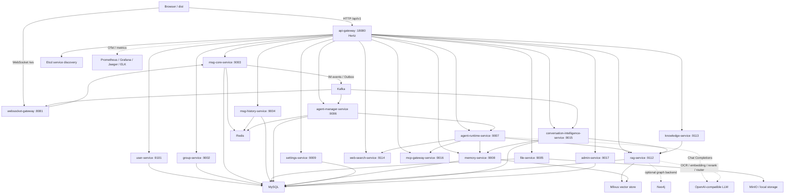
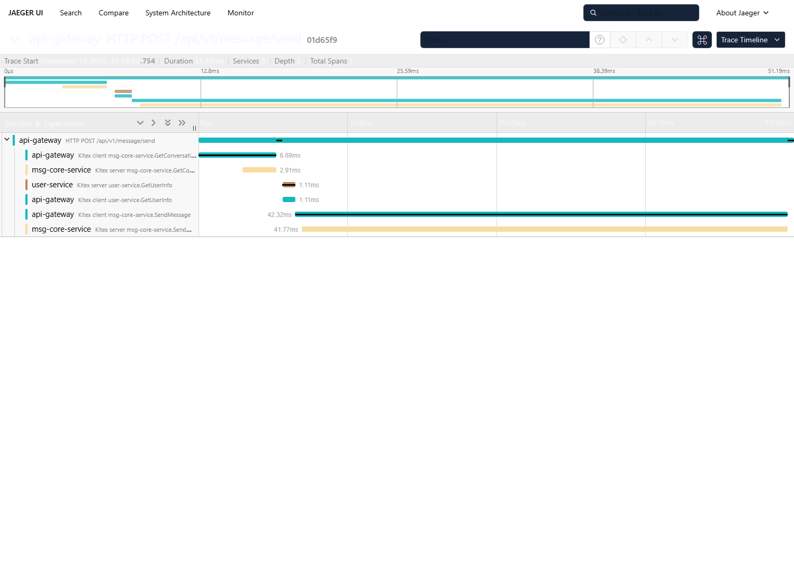
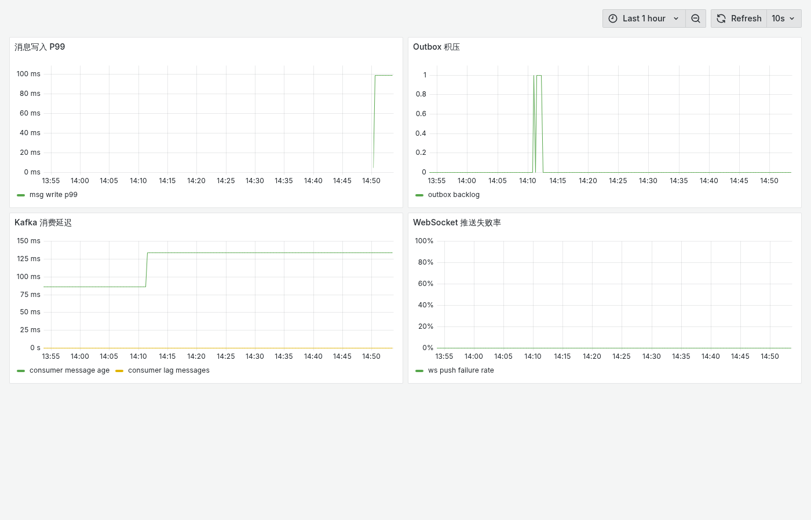

# ClaranAIM

[](https://github.com/Claran309/ClaranAIM/actions/workflows/ci.yml)

ClaranAIM 是一个 Agent-Native AIM 系统，AIM = Agent + Instant Messaging。

它不是把聊天机器人挂在 IM 旁边，而是把 Agent 做成 IM 里的真实成员：Agent 有自己的系统用户身份、会话、权限、记忆、Skill、MCP 工具和审计记录，可以进入私聊和群聊，读取授权上下文，处理文件与知识库，并把关键结论写回长期记忆。

17 个服务按领域拆分，真正需要按领域理解的只有 3 个核心域：

| 核心域 | 负责什么 | 关键问题 | 关键方案 | 验证方式 |
| --- | --- | --- | --- | --- |
| 消息一致性域 | 会话、消息事实、已读游标、Outbox、WebSocket 推送 | 写库成功但事件丢失、重复投递、多端乱序 | 消息与 Outbox 同事务、consumer 幂等表 + 死信、用户级同步游标 | msg-core 单测 + 4 个真实 MySQL 集成测试；一条发送链路 7 span 跨 3 服务 |
| Agent 运行时域 | 配置、权限、长会话、运行预算、工具审批、Eino 执行 | 长会话丢失、工具越权、失控调用 | MySQL 会话 + 滚动摘要、Eino checkpoint 恢复、RunBudget 四维预算、高风险工具审批中断 | 会话/运行/审批/checkpoint 真实 MySQL 测试；预算与恢复单测 |
| 知识与记忆域 | RAG 入库、Hybrid 检索、GraphRAG、长期记忆治理 | 检索质量无法量化、记忆越积越脏 | 父子切片 + BM25/向量 RRF、可配置质量门禁、候选记忆 → 确认 → 巩固 | 50 条检索评测：Hybrid RRF Recall@5 = 1.000；权限泄漏 0 |

其余服务提供 IM 基础能力（用户、好友、群、文件、历史、设置）和治理入口（admin、MCP Gateway、conversation-intelligence），与 3 个核心域共同组成完整系统。

**实现边界**：Kitex、Thrift、Hertz、Eino ADK、GORM、Kafka-go、Milvus/Neo4j 客户端、OpenTelemetry SDK 属于框架与基础设施；项目代码负责服务拆分与边界、消息/Outbox/幂等/游标的一致性设计、Agent 会话与运行预算/审批恢复、RAG 切片与检索编排、记忆候选与巩固、CI 与可观测性。Eino 提供 DeepAgent 与 checkpoint 机制，审批中间件、预算追踪、运行记录和恢复入口由本项目实现。

**成本可观测**：Agent 运行弹窗里的“运行记录与成本”读取 `agent_runs`，展示每次运行的状态、步数、输入/输出 token、美元成本和中断原因；数据由 runtime 写入。

**已知限制**：本地默认 embedding 是 `glm`，未配置 Key 时才回退 hash（启动日志会告警）；CRAG/Self-RAG 默认是规则版质量门禁，不是论文实现；rerank 在当前 50 条合成评测上没有提升；多 Agent 群聊协作（Phase 7）尚未开始；K8s 和灰度发布暂不在范围内；压测使用仓库内 `bench/loadgen`。

## 核心能力

- **Agent 原生 IM**：Agent 可作为真实系统用户进入私聊和群聊，读取授权上下文，执行总结、问答、洞察、回复建议、Skill 和工具调用
- **可靠消息同步**：支持 WebSocket 实时推送、上线同步、用户级同步游标、ACK 重试、乱序补偿和多端去重合并，ACK 表示设备收到，不等同于已读
- **Conversation Intelligence**：会话活动可自动或手动归档为摘要、决策、待办、主题、引用和候选记忆，并写入长期 RAG / Memory 治理链路
- **未读摘要**：聊天页提供“我错过了什么”，只总结当前用户未读范围，不自动标记已读
- **RAG 与知识图谱**：支持文档上传、异步解析、OCR、Hybrid Search、Rerank、GraphRAG、知识图谱查询、关系审核、文档图谱重建和可视化；质量门禁默认为可配置的规则版 CRAG/Self-RAG，可选 LLM judge
- **MCP / Tool / Skill**：提供 MCP Server 配置、工具调用、调用追踪、Agent Skill 上传、运行测试和工具执行标识
- **系统治理台**：管理员可管理用户、群组、文件、Agent、账单、审核、MCP 调用、公告、审计和可观测性入口，并可把其他用户设为管理员或降回普通用户
- **可观测性**：接入 OpenTelemetry、Prometheus、Grafana、Jaeger、ELK 和本地日志目录，便于排查网关、Kitex 服务、Agent 和 RAG 链路

## RAG 检索评测

评测集固定为 25 个主题 × 2 条 query，共 50 条；语料 26 个 chunk，其中 1 个是仅 owner 2 可见的权限拒绝样本。评测同时检查召回质量和权限泄漏。

```powershell
$env:RAG_EVAL_EMBEDDING="glm"
$env:RAG_EMBEDDING_API_KEY="<your-key>"
go test ./internal/rag-service/service/... -run TestRetrievalEvalReport -v
```

最近一次使用 GLM `embedding-3` 的结果：

| 策略 | Recall@5 | MRR | nDCG@5 | negative_false_rate | permission_leak_rate |
| --- | --- | --- | --- | --- | --- |
| keyword_only | 0.960 | 0.960 | 0.960 | 0.080 | 0.000 |
| vector_only | 0.980 | 0.887 | 0.910 | 0.250 | 0.000 |
| hybrid_rrf | 1.000 | 0.952 | 0.964 | 0.250 | 0.000 |
| hybrid_rrf_rerank | 1.000 | 0.952 | 0.964 | 0.250 | 0.000 |

结论：Hybrid RRF 把 Recall@5 从 keyword-only 的 0.960 提升到 1.000；在这组合成 hard-negative 上，本地 rerank 没有提升 MRR/nDCG，因此不把“Rerank 一定更好”写成结论。模型 rerank 需要在真实业务数据上重新评测。`negative_false_rate=0.250` 说明负例仍会被召回，后续 R5 的 Self-RAG 门禁要负责阻止“资料不足却硬答”。

默认 `rag.embedding_provider` 和 `memory_rag.embedding_provider` 都是 `glm`；只有测试/离线评估才允许 hash fallback，启动时会打印 `embedding_provider=hash` 警告。

## RAG 质量门禁

默认实现是 **Rule-based quality gate**，不是论文级 CRAG/Self-RAG：

- `RuleCRAGEvaluator` 根据 retrieval quality、coverage、specificity、conflict 输出 correct/incorrect/ambiguous。
- `RuleSelfRAGJudge` 输出 `IsRel`、`IsSup`、`IsUse`。
- 所有阈值都在 `pkg/config/config.go` 中配置（`rag.crag_*`、`rag.self_rag_relevance_threshold`），不硬编码。
- 阈值出处写在同一处注释里（来自 50 条评测的分数分布，不是凭空取值）；改阈值必须重跑 `TestRetrievalEvalReport`。
- 配置 `rag.router_provider=llm` 时可启用 LLM CRAG/Self-RAG judge；LLM 超时、返回非 JSON 或状态码异常时自动回退规则版。


## 文档索引
|  文档   | 索引  |
|  ----  | ----  |
| DeepWiki项目解析  |**[DeepWiki-ClaranAIM](https://deepwiki.com/Claran309/ClaranAIM.)** |
| 项目总结  |**[AIM项目总结梳理](https://www.claran-blog.work/go-AIM/)** |
| API 文档  |**[apiDoc.md](docs/apiDoc.md)** |
| 架构决策  |**[ADR-0001 agent 服务边界](docs/design-decisions/0001-agent-service-boundary.md)** |
| 阶段计划  |**[plan.md](docs/plan.md)** |

## 架构图



## 服务简介

| 服务 | 端口 | 类型 | 简介 |
| --- | --- | --- | --- |
| `api-gateway` | `18080` | Hertz HTTP | 浏览器统一 HTTP 入口，承载 `/api/v1/*`、鉴权、限流、文件预览、管理路由和内部 RPC 聚合 |
| `websocket-gateway` | `8081` | WebSocket | IM 实时连接网关，消费消息事件并推送到在线端 |
| `user-service` | `9101` | Kitex RPC | 用户、登录、Token、个人资料、好友、好友分组和角色基础能力 |
| `group-service` | `9002` | Kitex RPC | 群组、成员、角色、禁言、邀请、转让和群状态治理 |
| `msg-core-service` | `9003` | Kitex RPC | 会话、消息写入、编辑、撤回、已读、本地删除、Outbox 和同步游标 |
| `msg-history-service` | `9004` | Kitex RPC | 历史消息、离线索引、未读统计和消息检索 |
| `file-service` | `9005` | Kitex RPC | 文件元数据、MinIO / 本地存储引用、下载和治理信息 |
| `agent-manager-service` | `9006` | Kitex RPC | Agent 配置、权限、路由规则、事件调度、审计、计费和运行记录 |
| `agent-runtime-service` | `9007` | Kitex RPC | Eino Agent 运行时、工具安全策略、Skill 注入、长会话和任务执行 |
| `memory-service` | `9008` | Kitex RPC | 长期记忆、候选记忆、Memory-RAG、Milvus 召回和用户记忆治理 |
| `settings-service` | `9009` | Kitex RPC | LLM 预设、Prompt 模板、Skill 包、MCP Server 配置和密钥加密存储 |
| `rag-service` | `9112` | Kitex RPC | 文档入库、解析、OCR、chunk、embedding、Hybrid Search、Rerank 和 GraphRAG 构建 |
| `knowledge-service` | `9113` | Kitex RPC | 知识图谱查询、节点详情、边详情、邻域、路径和前端图谱视图聚合 |
| `web-search-service` | `9114` | Kitex RPC | 一次性 Web Search Augmentation，搜索、抓取、清洗和相关段落截取 |
| `conversation-intelligence-service` | `9015` | Kitex RPC | 聊天记录智能归档、未读摘要、摘要产物写入 RAG 和候选记忆生成 |
| `mcp-gateway-service` | `9016` | Kitex RPC | MCP 工具注册、远程 MCP 调用、工具追踪和 Agent 工具统一出口 |
| `admin-service` | `9017` | Kitex RPC | 管理台聚合数据、用户治理、群组治理、文件治理、审核、公告和审计 |

## 技术栈

| 分类 | 技术 |
| --- | --- |
| HTTP 框架 | Hertz |
| RPC 框架 | Kitex、Thrift、TTHeader |
| 服务发现 | Etcd |
| Agent 框架 | Eino |
| 数据库 | MySQL、GORM |
| 缓存 | Redis |
| 对象存储 | MinIO、本地存储 |
| 消息与一致性 | Kafka、Transactional Outbox、DTM Saga |
| RAG | Hybrid Search、BM25、RRF、Rerank、Rule-based CRAG/Self-RAG quality gate（可选 LLM judge）、Adaptive Router、parent-child chunk |
| 向量与图谱 | Milvus、Neo4j、GraphRAG |
| 前端 | 原生 HTML、CSS、JavaScript、G6 知识图谱可视化 |
| 认证与安全 | JWT、bcrypt、AES-GCM |
| 配置 | Viper、godotenv、.env、config/*.yaml |
| 日志 | Zap |
| 指标与追踪 | OpenTelemetry、Prometheus client、OTLP HTTP、Jaeger |
| 看板 | Grafana、Prometheus、Jaeger、ELK / Kibana |
| 部署 | Docker Compose、PowerShell / Batch |

## 目录结构

```text
ClaranAIM/
├── cmd/
    ├── api-gateway/
    ├── websocket-gateway/
    ├── user-service/
    ├── group-service/
    ├── msg-core-service/
    ├── msg-history-service/
    ├── file-service/
    ├── agent-manager-service/
    ├── agent-runtime-service/
    ├── memory-service/
    ├── settings-service/
    ├── rag-service/
    ├── knowledge-service/
    ├── web-search-service/
    ├── conversation-intelligence-service/
    ├── mcp-gateway-service/
    └── admin-service/
├── internal/
    ├── api-gateway/                         # HTTP handler、路由、中间件、RPC client
    ├── websocket-gateway/                   # WebSocket Hub、连接管理、事件消费
    ├── user-service/                        # 用户、好友、资料、角色
    ├── group-service/                       # 群组、成员、DTM 分支
    ├── msg-core-service/                    # 会话、消息事实、Outbox、同步游标
    ├── msg-history-service/                 # 历史消息、离线消息、未读统计
    ├── file-service/                        # 文件元数据、存储适配
    ├── agent-manager-service/               # Agent 配置、权限、事件调度、审计、计费
    ├── agent-runtime-service/               # Eino Agent、工具、Skill、长会话
    ├── memory-service/                      # 长期记忆、候选记忆、Memory-RAG
    ├── settings-service/                    # LLM Profile、Prompt、Skill、MCP 配置
    ├── rag-service/                         # 文档解析、检索、GraphRAG
    ├── knowledge-service/                   # 图谱查询与可视化聚合
    ├── web-search-service/                  # 搜索增强
    ├── conversation-intelligence-service/   # 会话归档、未读摘要
    ├── mcp-gateway-service/                 # MCP 工具网关
    └── admin-service/                       # 管理台聚合服务
├── pkg/
│   ├── agentkit/                          # Agent 共享库：模型工厂、会话存储、中间件、工作区沙箱、Graph 工具
│   ├── cache/redis/                       # Redis 客户端
│   ├── config/                            # 配置加载和环境变量覆盖
│   ├── documentparser/                    # 文档解析与 OCR 适配
│   ├── dtm/                               # DTM Saga 封装
│   ├── eventbus/                          # Kafka 发布、消费和可靠处理
│   ├── events/                            # 统一事件 Envelope 和 topic
│   ├── governance/                        # Kitex 超时、熔断、限流配置
│   ├── health/                            # 启动健康检查
│   ├── idgen/                             # 雪花 ID、十位 UID、十位群号
│   ├── jwt/                               # access token / refresh token
│   ├── logger/                            # Zap 日志
│   ├── observability/                     # OTel、metrics、trace
│   ├── outbox/                            # 事务 Outbox
│   ├── password/                          # bcrypt
│   ├── pricing/                           # 模型 token 价格估算（manager/runtime 共用）
│   └── response/                          # HTTP 响应封装
├── idl/                                     # Thrift IDL
├── kitex_gen/                               # Kitex 生成代码
├── config/                                  # 各服务 YAML 配置
├── dist/
    ├── index.html
    ├── css/
    └── js/
├── deployment/
    └── docker/
        ├── Dockerfile.service               # 通用服务镜像构建文件
        ├── docker-compose.infra.yaml        # 一体式基础设施 compose
        ├── docker-compose.full.yaml         # 基础设施 + Go 服务 compose
        ├── milvus/
        ├── neo4j/
        └── observability/
            ├── config/prometheus.yaml           # 抓取配置
            ├── config/prometheus-rules.yaml     # Outbox/Kafka/WS/消息写入告警
            └── config/grafana/dashboards/       # ClaranAIM Overview / Reliability 面板
├── docs/
    ├── apiDoc.md
    ├── plan.md
    ├── design-decisions/
    ├── update/
    ├── learn/
    └── AI assistent/
├── scripts/
    ├── service-control.ps1
    ├── start.bat
    ├── stop.bat
    ├── status.bat
    └── e2e-smoke.ps1
├── storage/                                 # 本地运行时文件目录
├── logs/                                    # 本地日志目录
├── .env.example
├── .dockerignore
├── .gitignore
├── go.mod
├── go.sum
└── README.md
```


## 部署方式

### 方式一：Docker 启动基础设施，本地启动 Go 服务


准备环境：

- Go 1.25+
- Docker Desktop / Docker Compose
- Windows PowerShell

复制环境变量：

```powershell
Copy-Item .env.example .env
```

配置项以 `.env.example` 内的注释为准，复制为 `.env` 后按需填写本地密钥、模型、OCR、RAG、可观测性和基础设施地址

首次启动空库时，请在 `.env` 中设置 `BOOTSTRAP_ADMIN_USERNAME`、`BOOTSTRAP_ADMIN_PASSWORD` 和 `BOOTSTRAP_ADMIN_NICKNAME`。`user-service` 只会在 `users` 表为空时创建这个账号并设置为 `admin`，已有任何用户时不会自动创建或修改管理员

启动除 Go 服务外的完整基础设施：

```powershell
docker compose -f deployment\docker\docker-compose.infra.yaml up -d
```

启动本地 Go 服务：

```powershell
scripts\start.bat
```

查看服务状态：

```powershell
scripts\status.bat
```

停止本地 Go 服务：

```powershell
scripts\stop.bat
```

打开前端：

```text
dist/index.html
```

默认访问地址：

- HTTP API：`http://localhost:18080/api/v1`
- WebSocket：`ws://localhost:8081/ws`
- Grafana：`http://localhost:8086`
- Jaeger：`http://localhost:8085`
- Prometheus：`http://localhost:8084`
- MinIO Console：`http://localhost:9001`
- Neo4j Browser：`http://localhost:7474`

### 方式二：Docker Compose 启动基础设施和 Go 服务

复制环境变量：

```powershell
Copy-Item .env.example .env
```

配置项以 `.env.example` 内的注释为准，全量 Docker 模式会由 `docker-compose.full.yaml` 为服务容器注入容器网络地址

如果是清空表后的首次部署，同样需要先在 `.env` 中设置 `BOOTSTRAP_ADMIN_USERNAME`、`BOOTSTRAP_ADMIN_PASSWORD` 和 `BOOTSTRAP_ADMIN_NICKNAME`。管理员引导只在 `users` 表为空时执行一次，后续可在管理面板的用户页把其他用户设为管理员或降回普通用户

启动全量环境：

```powershell
docker compose -f deployment\docker\docker-compose.full.yaml up -d --build
```

查看容器状态：

```powershell
docker compose -f deployment\docker\docker-compose.full.yaml ps
```

查看某个服务日志：

```powershell
docker compose -f deployment\docker\docker-compose.full.yaml logs -f api-gateway
```

停止全量环境：

```powershell
docker compose -f deployment\docker\docker-compose.full.yaml down
```

默认对外暴露：

- `api-gateway`：`http://localhost:18080`
- `websocket-gateway`：`ws://localhost:8081/ws`
- Grafana：`http://localhost:8086`
- Jaeger：`http://localhost:8085`
- Prometheus：`http://localhost:8084`
- MinIO Console：`http://localhost:9001`
- Neo4j Browser：`http://localhost:7474`

## 本地脚本

| 脚本 | 用途 | 是否建议保留 |
| --- | --- | --- |
| `scripts\start.bat` | 日常本地启动入口，调用 `service-control.ps1 start`，会检查基础设施、跳过已运行服务、检测端口占用和启动错误日志 | 保留 |
| `scripts\stop.bat` | 停止当前仓库通过 `go run` 拉起的本地 Go 服务，不处理 Docker 基础设施 | 保留 |
| `scripts\status.bat` | 查看本地服务端口、PID、运行状态和端口占用来源 | 保留 |
| `scripts\service-control.ps1` | `start/stop/status` 的共享实现，避免三个 bat 文件重复维护服务清单和端口检查逻辑 | 保留 |
| `scripts\e2e-smoke.ps1` | 可选本地验收脚本，用于检查前端 JS 语法、Go 包构建和一些文档/目录约束，不是日常启动必需 | 保留 |


## 开发与测试

## 可观测性样板

`gateway → msg-core → MySQL → Outbox → Kafka → websocket` 是项目里最值得讲的一条链路，也是本轮补的观测样板。

实测一条 `POST /api/v1/message/send` 的 Jaeger trace 包含 7 个 span，跨 3 个服务：

```text
HTTP POST /api/v1/message/send                (api-gateway)
Kitex client msg-core-service.SendMessage     (api-gateway)
Kitex server msg-core-service.SendMessage     (msg-core-service)
Kitex client msg-core-service.GetConversationParticipants
Kitex server msg-core-service.GetConversationParticipants
Kitex client user-service.GetUserInfo
Kitex server user-service.GetUserInfo
```

查看方式：`http://127.0.0.1:8085` 搜索 service=`api-gateway`，或直接打开 trace 页面（示例 trace：`http://127.0.0.1:8085/trace/01d65f934fc0c9b4f04aee1276992a71`）。



四个可靠性指标（Prometheus `claran_business_*`）：

| 指标 | 查询 | 本次实测 |
| --- | --- | --- |
| 消息写入 P99 | `histogram_quantile(0.99, sum by (le) (rate(claran_business_duration_ms_bucket{domain="msg_core",operation="send_message"}[5m])))` | 49.75 ms |
| Outbox 积压 | `max(claran_business_gauge{domain="outbox",name="backlog"})` | 0 |
| Kafka 消费延迟 | `max(claran_business_gauge{domain="kafka_consumer",name="message_age_seconds"})` | 0.024 s |
| WS 推送失败率 | `max(claran_business_gauge{domain="websocket",name="push_failure_rate"})` | 0 |

两个告警规则在 `deployment/docker/observability/config/prometheus-rules.yaml`，已用 `promtool` 校验并加载：

- `ClaranOutboxBacklogHigh`：Outbox backlog > 1000 持续 5 分钟。
- `ClaranKafkaConsumerLagHigh`：消费消息年龄 > 30 秒持续 2 分钟。

另外两条辅助告警：`ClaranWebSocketPushFailureRateHigh`（>5%）、`ClaranMsgWriteP99High`（>500ms）。

Reflection 也有独立指标和告警（`deployment/docker/observability/config/prometheus-reflection-rules.yaml`）：

- `agent_reflection_total{result="pass|revise|fail|skip"}`，用于按结果聚合失败率。
- `agent_reflection_latency_ms`、`agent_reflection_tokens`、`agent_reflection_changed`、`agent_reflection_issues`。
- `ClaranReflectionFailureRateHigh`（失败率 >20%）、`ClaranReflectionLatencyHigh`（P95 >8s）。

面板：Grafana `ClaranAIM Reliability`（uid `claran-reliability`），含消息写入 P99、Outbox 积压、Kafka 延迟、WS 失败率四张图。



复现步骤：

```powershell
docker compose -f deployment/docker/docker-compose.infra.yaml --env-file .env up -d etcd kafka redis otel-collector jaeger prometheus grafana
go build -o .smoke-bin/api-gateway.exe ./cmd/api-gateway
# 启动 user/msg-core/websocket/api-gateway 后发一条消息，然后查询上面四个 PromQL
```

限制：本地链路默认关闭 Kafka 时 Outbox 只会积压不发布；Kafka 消费指标只有在 `websocket-gateway` 实际消费到消息后才出现。

## 压测与容量基线

在 16GB Windows 单机、Docker VM 7.6GiB 下用 `bench/loadgen` 做本地压测
（mock LLM / mock embedding，固定 commit、固定数据量，每组 3 次取中位数）：

| 场景 | 结果 |
|---|---|
| 读路径（会话 + 历史） | 1590 RPS @10VU / 2135 RPS @20VU，P99 14.7 / 21.8ms |
| 单聊写入 | 198 / 290 / 430 msg/s @10/20/50VU，P99 92.9 / 163.3 / 329.2ms |
| 群聊扇出（10 群，平均 105 人） | 40.2 msg/s，P99 773ms，约 105 行 `message_user_states`/消息 |
| 故障注入 | MySQL 停 30s 后 31s 恢复；Kafka 停 60s 后 13751 条全部补发；kill -9 msg-core 后 1.4s 恢复；均 0 丢失 |
| Outbox 优化 | 排空 46 → 285-483 events/s；C3 20VU P99 163 → 110-115ms |

原始数据、对账 SQL、环境说明和压测结论见 `bench/` 与 `bench/report/`。
这些数字只代表上述单机、单分区、mock 依赖配置，不代表生产容量。

## Agent Reflection

Agent 最终输出后会经过一轮 critic 自检（`internal/agent-runtime-service/reflection`）：

- critic 只输出 JSON：`{"complete","grounded","issues","revised_answer"}`；
- 只有 `complete=false` 或 `grounded=false` 才改写，且最多 1 轮；
- critic 超时、返回非 JSON、token 超预算时保留原稿，并把原因写入 `agent_runs.reflection_json`；
- 高风险工具（写文件/执行命令/发消息）在 critic 确认前不算完成；
- Reflection 的输入/输出 token 和成本写入运行记录，但不记录答案正文。

Self-RAG 已从“只打印”升级为最终答案门禁（R5）：

- `IsRel=false`：本轮检索结果不可用，工具输出会要求换关键词或澄清问题；
- `IsSup=false`：禁止把答案草稿当确定结论，工具输出显式标记“资料不足”；
- `IsUse=false`：先追问用户真实目标，再决定是否继续检索；
- Agent 最终答案若在没有依据时给出“根据资料可以确定/文档明确指出”等确定性措辞，会被降级为“资料不足”说明。

Reflection 评测集（`internal/agent-runtime-service/reflection/eval_test.go`）固定 50 条，分四类：

```powershell
go test ./internal/agent-runtime-service/reflection/... -run TestReflectionEvalReport -v
```

最近一次脚本化 critic 结果：

| 类别 | 用例数 | 改善 | 伤害 |
| --- | --- | --- | --- |
| 该改（答非所问/编造/漏证据） | 20 | 20 | 0 |
| 不该改（已正确） | 15 | 0 | 0 |
| 预算边界（超时/超 token） | 10 | 0 | 0 |
| 安全边界（不泄漏内部提示） | 5 | 0 | 0 |

`changed_rate=0.40`、`improve_rate=0.40`、`harm_rate=0.00`。这组数字证明门禁和回退路径可工作，不代表真实模型的批判质量；真实模型评测需要设置 `REFLECTION_EVAL_LIVE=true` 和对应 critic 配置。

提交前跑一遍与 CI 相同的门禁：

```bash
gofmt -l cmd internal pkg   # 应输出为空
go vet ./...
golangci-lint run ./...
go build ./...
go test -race ./...
```

服务边界约束由架构测试保护，改了 import 之后可以单独跑：

```bash
go test ./internal/architecture/... -v
```

`pkg/agentkit` 的共享能力（会话存储、工作区沙箱）有独立单元测试：

```bash
go test ./pkg/agentkit/... -v
```

MySQL 集成测试默认跳过，需要本地 MySQL 8+ 并显式提供 DSN：

```powershell
$env:CLARAN_TEST_MYSQL_DSN="root:root@tcp(127.0.0.1:3306)/claran_test?charset=utf8mb4&parseTime=True&loc=Local"
go test -tags=integration ./internal/msg-core-service/service/... -v
```

CI 配置在 [`.github/workflows/ci.yml`](.github/workflows/ci.yml)，包含 gofmt、go vet、golangci-lint、go build、`go test -race`、msg-core MySQL 集成测试和 compose 文件校验。

集成测试覆盖 8 组真实 MySQL 场景（串行执行，避免共享 `event_outbox` 表互相清表）。核心 3 个服务共 36 个集成测试（msg-core 13、agent-runtime 13、agent-manager 10）：

```bash
go test -p 1 -tags=integration ./internal/msg-core-service/service/...
go test -p 1 -tags=integration ./internal/agent-runtime-service/store/...
go test -p 1 -tags=integration ./internal/agent-runtime-service/service/...
go test -p 1 -tags=integration ./internal/agent-manager-service/dao/...
go test -p 1 -tags=integration ./internal/memory-service/service/...
go test -p 1 -tags=integration ./internal/group-service/service/...
go test -p 1 -tags=integration ./pkg/eventbus/...
go test -p 1 -tags=integration ./pkg/outbox/...
```

真实 Kafka 场景单独用 `CLARAN_TEST_KAFKA_BROKERS` 开启（CI 已配置 broker）：

```powershell
$env:CLARAN_TEST_KAFKA_BROKERS="127.0.0.1:9092"
go test -p 1 -tags=integration ./pkg/eventbus/... -run TestIntegrationKafkaBrokerDuplicateDeliveryIsIdempotent -v
```

该用例向临时 topic 写入两条相同 `event_id` 的消息，验证消费侧幂等表只执行一次；未设置 broker 时自动 `SKIP`。

契约与可靠性约束也有自动化测试：`internal/architecture` 校验跨服务 import、IDL 与生成代码同步、Thrift 字段编号唯一、RPC 方法存在；`pkg/eventbus` 用 MySQL 主键唯一约束验证两个 consumer 实例并发时同一事件只执行一次；`pkg/governance` 验证连续超时后 Kitex 熔断返回 `ErrCircuitBreak`，关闭熔断后调用恢复。

## 运维与排障

- 本地服务状态：`scripts\status.bat`
- 本地服务日志：`logs/INFO`、`logs/ERR`
- 本地运行数据：`storage/`
- 基础设施 compose：`deployment/docker/docker-compose.infra.yaml`
- 全量 compose：`deployment/docker/docker-compose.full.yaml`
- 服务镜像 Dockerfile：`deployment/docker/Dockerfile.service`
- 可观测性配置：`deployment/docker/observability/`
