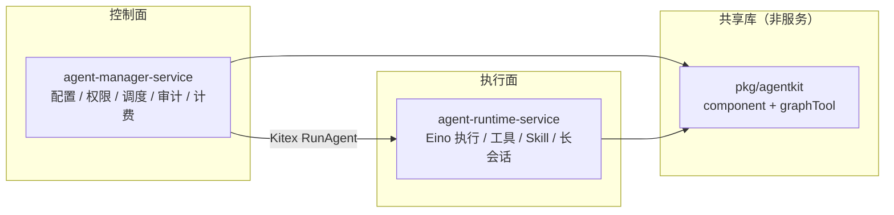

# ADR-0001：agent-manager 与 agent-runtime 的服务边界

- 状态：已采纳
- 日期：2026-11-23
- 范围：ClaranAIM `agent-manager-service`、`agent-runtime-service`、`pkg/agentkit`

## 背景

`agent-manager-service` 负责 Agent 配置、权限、事件调度、审计和计费；`agent-runtime-service` 负责真正的 Eino Agent 执行、工具、Skill 和长会话。两个服务在演进过程中复制了 5 个字节级完全相同的文件：

- `component/memory.go`
- `component/middleware.go`
- `component/model.go`
- `graphTool/rag.go`
- `graphTool/websearch.go`

更严重的是，`agent-manager-service` 直接 import 了 `internal/agent-runtime-service/component` 来复用 `WorkspaceSandbox`，形成了跨服务 `internal` 依赖。这会让两个服务无法独立部署和独立演进，也会让“服务边界”只停留在目录名上。

## 决策

采用**方案 B**：把共享实现抽到 `pkg/agentkit`，两个服务只依赖公共包，不合并两个服务。

```text
pkg/agentkit/
├── component/        # ChatModel 工厂、JSONL 会话存储、工具安全/审批中间件、工作区沙箱
└── graphTool/        # RAG 文档问答工具、Web Search 工具
```



边界规则：

1. `internal/<service>` 只能 import 自己的子包、`ClaranAIM/pkg`、`ClaranAIM/kitex_gen`，不能 import 另一个服务的 `internal`。
2. `pkg/agentkit` 不能反向依赖任何 `internal/<service>`，保证它能被独立测试和复用。
3. 服务之间只通过 RPC、事件和 HTTP 契约交互。
4. `pkg/agentkit` 只收纳真正的通用实现；带业务状态或数据库访问的代码仍留在各自服务。

规则 1 和 2 由 `internal/architecture/service_boundary_test.go` 固化，`go test ./...` 和 CI 会自动执行。

## 为什么不选方案 A（合并两个服务）

- 控制面和执行面的伸缩特征不同：manager 跟着配置/事件量走，runtime 跟着模型调用和工具执行走，合并会放大故障域。
- 现有部署和端口已经按两个服务拆分，合并会引入一次高风险迁移，收益却只是消除重复文件。
- 本次目标是先止血边界问题，不改变部署拓扑。

## 为什么不继续复制文件

复制能最快让编译通过，但会让同一个安全修复（例如工具审批中间件、工作区路径校验）在两个服务里漂移。`WorkspaceSandbox` 是安全边界代码，尤其不能有两份实现。

## 影响

- 删除两个服务下的 `component/`、`graphTool/` 目录，减少 5 个重复文件。
- `agent-manager-service` 不再 import `agent-runtime-service/internal`。
- 新增 `pkg/agentkit` 的单元测试：会话 JSONL 持久化/重载/删除、并发追加、工作区路径逃逸与命令路径校验。
- 新增架构测试，后续有人再跨服务 import `internal` 会直接 CI 失败。
- 不改变任何运行时协议、端口、数据库表或前端接口。

## 验证方式

```bash
go build ./...
go vet ./...
go test -race ./...
```

重点看：

```bash
go test ./internal/architecture/... -v
go test ./pkg/agentkit/... -v
```
